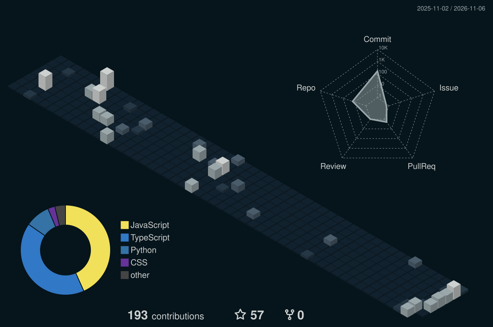

 

&nbsp;&nbsp;&nbsp;&nbsp;
&nbsp;&nbsp;&nbsp;&nbsp;
&nbsp;&nbsp;&nbsp;&nbsp;
&nbsp;&nbsp;&nbsp;&nbsp;

  

> Hey, I'm **Pushpender** — a **Software Engineer** and **Full-Stack Developer** (B.Tech CSE, Geeta University, 2023–27) who builds secure, scalable products on the **MERN stack and Next.js**. As a **Web Developer Intern at Bharti Airtel** I worked on **datX**, an enterprise data-automation platform with **RBAC and encrypted transmission**. I treat **AI as part of the architecture** — prompt engineering, LLM integrations, voice and vision features — never as a gimmick. **1st place at Hackforge 2.0** · **400+ LeetCode problems** · also a **UI/UX designer** who cares how software *feels*.

> - 🏗️ **Full-stack systems** — MERN, Next.js & TypeScript with JWT auth, RBAC and clean REST APIs
> - ⚡ **Real-time engineering** — WebSockets / Socket.IO apps with sub-50ms latency
> - 🤖 **AI-integrated products** — multilingual AI tutors, voice assistants, computer-vision tools, GenAI prototypes (Hugging Face)
> - 🎨 **UI/UX & motion** — responsive interfaces with Tailwind CSS and Framer Motion
> - 🧠 **Prompt engineering** — designing prompts and pipelines that make LLM features reliable
> - 🧩 **Problem solving** — 400+ DSA problems in C++ on LeetCode
> - 🌱 **Always learning** — system design, backend performance, cloud deployments

| Role | Company | When | Impact |
|:--|:--|:--:|:--|
| **Web Developer Intern** | Bharti Airtel | Jun–Aug 2026 | Built **datX**, a MERN data-automation platform for daily network records, with strict **RBAC** & encrypted transmission |
| **Full Stack Intern** | Jac Nutritions | Jun–Jul 2026 | Shipped responsive MERN apps; improved database query efficiency |
| **Generative AI Intern** | Skilligence EdTech | Jun–Jul 2025 | Multilingual translator (Hugging Face) at **95% accuracy**; cut inference time **20%** |

### 🏆 Growtix — Tech Learning Platform

> A multilingual tech-learning platform with an AI tutor and a live competitive arena.
>
> - 🌐 Supports **5+ regional languages**, with an intelligent tutor for instant doubt resolution, tutorials and real-time news alerts
> - ⚔️ **1v1 coding arena** over WebSockets with **<30ms latency**, plus an automated **mock-interview simulator**
> - ⚙️ **Stack:** React · Node.js · WebSockets · AI APIs
>
>  

<!-- ===== Jab ready ho to niche wale projects uncomment kar do (links badal dena) =====

### 🌾 AgroTech — Smart Farming Platform

> Multilingual farming platform with hybrid auth (JWT/Firebase) and a freemium subscription model.
>
> - 🎙️ Voice assistant and **Dr. Disease**, a computer-vision tool for instant crop-disease diagnosis
> - ⚙️ **Stack:** Next.js · Supabase · AI APIs
>
>  

### 💬 ChitChat — Real-Time Messaging App

> Real-time bidirectional chat with **<50ms latency**, JWT-secured sessions and MongoDB Atlas queries tuned for **15% faster loads**.
>
> - ⚙️ **Stack:** Socket.io · React · Node.js · MongoDB
>
>  

-->

<b>LANGUAGES</b> 

<b>FRONTEND</b> 

<b>BACKEND & DATABASE</b> 

<b>CLOUD & TOOLS</b> 

<b>CONCEPTS & AI</b> 

 

| 🏆 Hackathon | 🧩 Problem Solving | 🎓 Education |
|:--:|:--:|:--:|
| **1st Position** Hackforge 2.0 · Apr 2026 | **400+ problems** LeetCode · C++ | **B.Tech CSE** Geeta University · 2023–27 |

| ☁️ Certification | 💻 Certification | 📮 Certification |
|:--:|:--:|:--:|
| **Intro to Google Cloud** | **Software Engineer** HackerRank | **Postman Student Expert** Postman |

 

 

 

Open to **SDE roles**, internships and collaborations on impactful **AI + software** projects.

 

&nbsp;&nbsp;&nbsp;&nbsp;
&nbsp;&nbsp;&nbsp;&nbsp;
&nbsp;&nbsp;&nbsp;&nbsp;
&nbsp;&nbsp;&nbsp;&nbsp;

